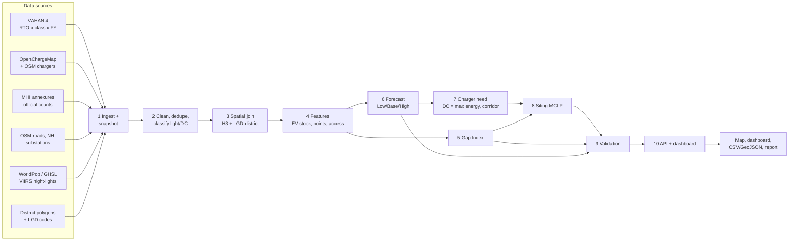
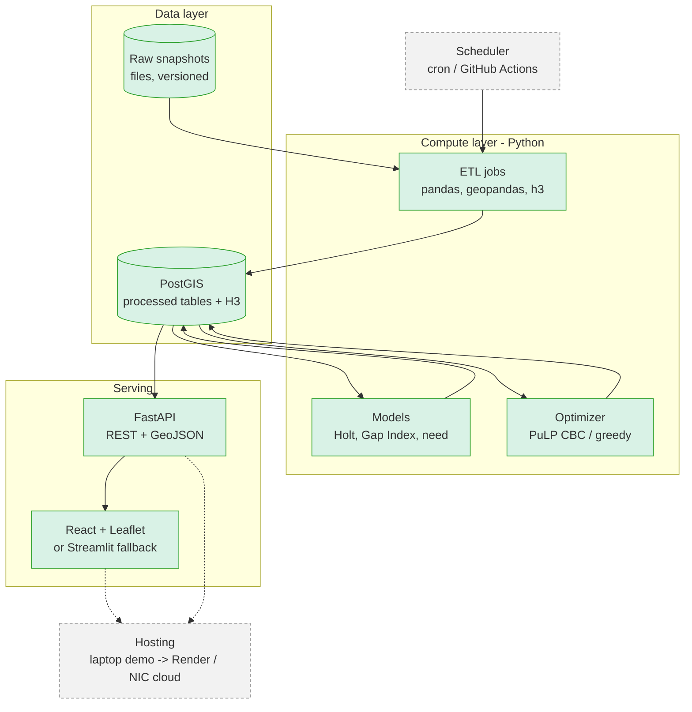
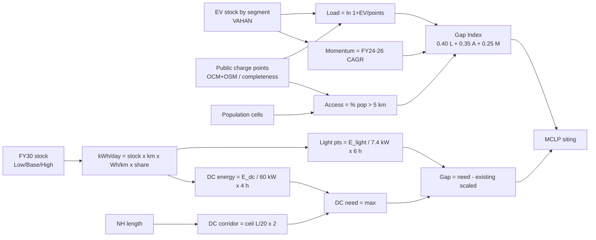
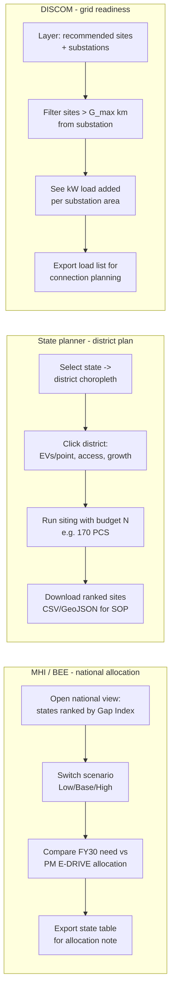

# Phase 4: Full Approach Design
**EV Infra Map India (C1) · Team TM-72BD3802D52 · Techfest IIT Bombay 2026-27 · 17 Oct 2026**

> This document is design only. It builds on [Phase1_Scope.md](Phase1_Scope.md), [Phase2_DataResearch.md](Phase2_DataResearch.md) and [Phase3_EDA_Forecast.md](Phase3_EDA_Forecast.md). Phase 3 Section 5 is binding.
> ⚠ marks an assumption or an unverified figure; all of them are listed in Section E.
> Round 2 deliverables are referred to as: **D1** web platform · **D2** GIS map · **D3** methodology document · **D4** charger-requirement module · **D5** dashboard · **D6** demo video · **D7** scalability roadmap.

---

## A. End-to-end pipeline

| # | Stage | Input | Method | Output | Tools | Quality checks | Feeds |
|---|---|---|---|---|---|---|---|
| 1 | **Ingest** | VAHAN 4 (RTO × class × FY, electric fuels); OCM export + API; OSM Overpass; MHI annexures; WorldPop/GHSL; VIIRS; OSM roads and substations | Scripted pulls with a snapshot date stamp; raw files are never edited | `raw/<source>/<date>/` | Python, requests, Overpass, git sparse-checkout | Row counts; date range; VAHAN segment sum = TOTAL | D1, D3 |
| 2 | **Clean / dedupe / geocode** | Raw chargers, VAHAN tables | One common schema; 15/50 m union-find dedupe; light/DC classification; drop captive and non-operational; geocode address-only records | `chargers_clean`, `vahan_clean` | pandas, geopandas | Duplicates removed; share of kW values imputed; missing coordinates; completeness vs MHI | D2, D3 |
| 3 | **Spatial join** | Clean layers, district polygons (OSM, LGD-coded), H3 grid | Point-in-polygon → LGD district; `h3.latlng_to_cell` (res 8 urban, res 7 rural); RTO→district crosswalk | Every record carries an `lgd_code` and an `h3` cell | geopandas, h3, PostGIS | 30 Odisha / 31 Karnataka polygons; no orphan points; area matches the official figure ±2% | D2 |
| 4 | **Features** | Joined layers | Per district and per H3 cell: EV stock by segment; charge points (light/DC); population; night-lights; distance to nearest charger, NH and substation | `features_district`, `features_h3` | pandas, rasterio | Totals reconcile to state; attrition applied | D4, D5 |
| 5 | **Gap Index** | Features | Weighted, min-max normalised score (B2) | `gap_index` (0–100) per district and per cell | pandas | Weight sensitivity: Spearman ρ, top-10 overlap | D2, D5 |
| 6 | **Forecast** | VAHAN FY18–FY26 | Holt damped trend per segment; Low/Base/High scenarios (B3) | EV stock FY27–FY30 by segment × district | statsmodels | Backtest MAPE; scenario ordering Low < Base < High | D4 |
| 7 | **Charger need** | Forecast, parameters, NH layer | Energy-based demand; DC = max(energy-based, corridor norm) (B4) | Required and gap points, light/DC × district × scenario | pandas | ±30% sensitivity; checks against the 2024 norms | D4, D5 |
| 8 | **Siting** | Need, H3 candidates, substations | MCLP integer program with a greedy fallback (B5) | Ranked new sites (H3 cell + nearest road/POI) | PuLP (CBC) / OR-Tools | Hold-out recovery; budget respected | D2, D4 |
| 9 | **Validation** | All model outputs | Backtest, norm compliance, hold-out, PM E-DRIVE overlap, sensitivity (B6) | `validation_report` | pandas, matplotlib | Pass/fail thresholds set in advance | D3, D6 |
| 10 | **Dashboard / API** | Processed tables in PostGIS | REST API and a web map with scenario switches | Web app and CSV/GeoJSON downloads | FastAPI, React + Leaflet (or Streamlit fallback) | API tests; tables load in under 2 s | D1, D2, D5, D6 |

---

## B. Method specifications

### B1. Data integration
**Demand: VAHAN to district**
- `EV[d,s,t] = Σ_r  w[r,d] · REG[r,s,t]`, where `w[r,d]` is the share of RTO *r* assigned to district *d*, and the shares for each RTO sum to 1.
- **Split rule:**
  - An RTO that sits wholly inside one district gets `w = 1`. This covers all 38 Odisha offices.
  - An RTO covering several districts is split by population share: `w[r,d] = pop(d ∩ jurisdiction_r) / pop(jurisdiction_r)` (WorldPop) ⚠. The record is flagged `is_assumed`.
  - State-level offices (STA OD99) are allocated by each district's share of RTO-registered EVs.
- **Stock:** `STOCK[d,s,T] = Σ_{t≤T} EV[d,s,t] · (1 − a_s)^(T−t)`. The attrition rate `a_s` comes from Phase 2 Table D ⚠.

**Supply: charger merge**
- Sources: OCM export/API + OSM + operator locators (Round 2) → one schema: `src_id, operator, lat, lon, n_points, max_kW, kw_class, access, status, flags`.
- **Deduplication** (union-find): two records are the same site if they are ≤ 50 m apart with the same operator, or ≤ 15 m apart with the same kW class. Keep the record with the most fields filled; store every `source_id`.
- **Class:** light if `max_kW` < 30, DC if ≥ 30. If kW is missing, use DC when there is a DC connector or a DC-heavy operator, otherwise light, and set `is_kw_imputed`.
- **Captive / closed filter:** drop OCM "Private*" usage types, OSM `access=private/customers/no`, and statuses where `IsOperational = False`.
- **Completeness:** `C_state = our_sites / MHI_stations`. Phase 3 found **Odisha 38%** (229 / 606 ⚠) and **Karnataka 6%** (415 / 6,805).

**Spreading demand to H3 cells**
- `EV[h] = EV[d] · (pop_h · NTL_h^β) / Σ_{h∈d} (pop_h · NTL_h^β)`
- β = 0.5 ⚠ (dampens night-light glare from industry). This allocation is modelled, so it is flagged `is_synthetic`.

**Refresh and versioning**
- Monthly VAHAN pull, weekly OCM/OSM, MHI annexure per Parliament session.
- Each run is stamped `snapshot_id`. Processed tables are append-only (`valid_from` / `valid_to`), and the dashboard shows the snapshot date.

> **Why this approach:** RTO-level VAHAN is the finest official EV count available. Weighting by population × night-lights is transparent and reproducible, unlike black-box downscaling.

### B2. Charging Gap Index v1 (0–100, higher = more underserved; district and H3)

| Component | Formula | Weight | Why |
|---|---|---|---|
| **Load** (L) | `ln(1 + EV_stock / (points_obs + 1))` | 40% | Pressure on today's public chargers. Log scale stops a single district dominating. |
| **Access** (A) | % of population living > 5 km ⚠ from any public charger (1 km for urban cells) | 35% | Equity: who cannot reach a charger at all |
| **Momentum** (M) | FY24→26 registration CAGR, capped at the 95th percentile (≈ 100%) | 25% | Where demand is growing fastest |

- `GI = Σ_k w_k · 100 · (x_k − min_k) / (max_k − min_k)`
- Phase 3 result: top-10 Odisha districts = Balangir 82.5, Dhenkanal 80.6, Kendrapara 79.2, Mayurbhanj 77.2, Bhadrak 74.6, Rayagada 74.6, Angul 74.3, Bargarh 73.1, Nabarangapur 72.5, Kalahandi 70.1.

**(a) Weight-sensitivity test (on the index itself)**

| Variant | Weights L / A / M | Metric reported |
|---|---|---|
| Base | 40 / 35 / 25 | — |
| Equal | 33 / 33 / 33 | Spearman ρ vs Base; top-10 overlap |
| ±10-point shifts (6 variants) | e.g. 50/25/25, 30/45/25, 40/25/35 … | ρ, overlap, maximum rank change |
| PCA-derived | First-component loadings, normalised | ρ, overlap |
| Leave-one-out (3 variants) | Drop one component and rescale | Shows which component drives the ranks |

Pass rule: **ρ ≥ 0.85 and top-10 overlap ≥ 8/10 across all variants**, otherwise the weights are reported as contested.

> Phase 3's ±30% test (9–10 of 10 districts stable) was run on the **FY30 gap in charge points, not on this index**. The two are reported separately.

**(b) Handling incomplete charger data**
- The **Load** component uses observed points, so it is biased if the missing chargers are not spread evenly across districts. The plan:
  - Publish both `GI_obs` and `GI_scaled` (points ÷ completeness).
  - Give each district a `data_confidence` flag (High/Med/Low from source count and age).
  - Report the rank change between `GI_obs` and `GI_scaled`. A rank change of 5 or more flags the district.
- **Access** depends on where chargers are, so scaling cannot fix it. Missing chargers can only make the true access gap smaller, so `GI_obs` is labelled an **upper bound on underservice** ⚠.

**(c) v2 components (Round 2, optional)**
- **Grid readiness:** distance to the nearest 33/11 kV substation (OSM, plus OPTCL lists).
- **Traffic:** NH toll-plaza PCU/day as a corridor weight.
- **Destinations:** density of tourism and logistics points of interest.
- Each v2 component is added only if it changes the ranking materially (ρ < 0.95 vs v1). Otherwise v1 stays, for simplicity.

### B3. Forecast
- **Model:** Holt damped additive trend, fitted per segment on Odisha state-level FY20–FY26 annual registrations.
  `ŷ_{t+h} = ℓ_t + (φ + φ² + … + φ^h) · b_t`, with φ, α, β fitted by maximum likelihood (statsmodels).
- **Backtest (Phase 3):** trained on FY20–FY24, tested on FY25–FY26. **Weighted MAPE 10.2%** (2W 6.2%, 4W 16.9%, 3W e-auto 48.4%, e-rickshaw 45.8%). Log-linear was **rejected at 507%**.

| Scenario | Definition (same as Phase 3) | FY30 stock (2W/3W/4W) |
|---|---|---|
| Low | FY24→26 CAGR `g₀`; year *t* growth = `g₀ · 0.5^t` | 6.8 lakh |
| Base | Holt damped trend | 8.3 lakh |
| High | EV share of new registrations rises linearly from FY26 actual to **50% by FY30** (draft Odisha EV Policy 2025 ⚠); segment markets held at FY26 level ⚠ | 14.4 lakh |

FY26 actual stock: 2.47 lakh.

- **3W weakness:**
  - 3W segments are under 10% of public energy (Base), so the forecast error has a limited effect on the result.
  - Report 3W with a ±50% band.
  - Round 2: model e-autos as EV share × 3W market, which is more stable than a pure trend. Leave e-rickshaws flat at Base.
- **District allocation:**
  - Now: `STOCK[d,s,FY30] = STOCK[s,FY30] · STOCK[d,s,FY26] / Σ_d STOCK[d,s,FY26]` ⚠ (a district's share is frozen).
  - Round 2: a hierarchical model. Fit a district share trend (log-ratio regression on FY22–FY26 shares), then reconcile the districts to the state total so they still sum to it.
- **Why Holt damped:** it gives the best backtest result and its parameters are interpretable. Damping matches an adoption curve that is levelling off. Prophet and ML models are not justified with 7 annual points.

### B4. Charger requirement (D4)

**Energy-based need**
- `E_pub[d] = Σ_s STOCK[d,s] · km_s · (Wh/km)_s / 1000 · share_s` (kWh/day)
- `E_DC = Σ_s E_pub[d,s] · dc_s`, and `E_light = E_pub − E_DC`
- `N_light = E_light / (P_light · H_light)` and `N_DC,energy = E_DC / (P_DC · H_DC)`

| Parameter | Value | Source |
|---|---|---|
| km/day (2W / e-auto / e-rickshaw / 4W) | 25 / 100 / 70 / 35⚠ | Phase 2 Table D |
| Wh/km | 33 / 60 / 77 / 123 | LBNL, WRI |
| Public share | 10% / 30%⚠ / 2.5%⚠ / 20%⚠ | Phase 2 Table D |
| 4W share of public energy at DC | 60% ⚠ | Assumed |
| Light charger | 7.4 kW × 6 h ⚠ | Assumed |
| DC charger | 60 kW × 4 h ⚠ | Assumed |

**New rule: corridor norm (MoP Guidelines, 17 Sep 2024)**
- `N_DC,corr[d] = Σ_{NH segments in d} ⌈L_seg / 20 km⌉ × 2 sides`
- Plus heavy-duty fast charging: `⌈L / 100 km⌉ × 2` on designated freight corridors (Round 2: confirm which corridors are designated).
- **`N_DC[d] = max(N_DC,energy, N_DC,corr)`**

**Urban norm check**
- In urban cells (GHSL SMOD urban), the target is ≥ 1 public station per 1 × 1 km by FY 2030. On H3 res 8 (≈ 0.74 km²), this is measured as **% of cells with a public charger ≤ 1 km away**.
- Bhubaneswar today: **24.6%**, with 19 stations against about 147 implied by the norm.

- **Gap** = max(0, N_req − N_existing_scaled), separately for light and DC.

**Worked example: Baleshwar district (Base, FY 2029-30)**

| Step | Value |
|---|---|
| EV stock FY26 → FY30 | 2W 14,225 → 48,493 · e-auto 1,315 → 3,892 · e-rickshaw 2,770 → 4,481 · 4W 397 → 2,019 |
| Public kWh/day | 2W 4,001 + e-auto 7,005 + e-rickshaw 604 + 4W 1,738 = **13,348** |
| Light | 12,305 kWh ÷ (7.4 × 6) = **277 points** |
| DC, energy-based | 1,043 kWh ÷ (60 × 4) = **4.3 points** |
| DC, corridor-based | NH-16 ≈ 116 km in the district ⚠ (half of the OSM dual-carriageway length, 232 km) → ⌈116/20⌉ × 2 = **12 sites** |
| **DC need** | max(4.3, 12) = **12** |
| Existing (scaled ⚠) | light 12 / 0.38 = 32; DC 4 / 0.38 = 11 |
| **Gap** | **light ≈ 245 · DC ≈ 1** (count). The location gap is larger: up to 49 km between chargers on NH-16 in Odisha. |

**State level (Base, energy-based):** 2,822 light + 115 DC needed, against 553 + 188 existing (scaled). The NH-16 corridor alone needs ⌈437/20⌉ × 2 = **44 DC sites** ⚠ (437 km length clipped), so **the corridor rule dominates DC need**.

### B5. Siting: Maximal Covering Location Problem (MCLP)

**Sets**
- *I* = demand cells (H3)
- *J* = candidate cells. Candidates are cells with road access that contain a fuel station, mall, public car park, government office or rail/bus station (OSM), plus PM E-DRIVE sites.
- `N_i = {j : dist(i,j) ≤ R_i}`, where the radius is R = 1 km urban, 5 km rural ⚠, and 20 km on corridors.

**Variables:** `x_j ∈ {0,1}` (open a station at *j*); `y_i ∈ {0,1}` (demand cell *i* is covered).

**Objective:** `max Σ_i w_i · y_i − λ · Σ_j g_j · x_j`
- `w_i` = unmet public kWh/day in cell *i* (from B4, after existing coverage)
- `g_j` = grid penalty = distance to the nearest substation (km) ⚠ with λ tuned, or a hard constraint `x_j = 0` if `g_j > G_max` (5 km ⚠)

**Constraints**
- `y_i ≤ Σ_{j∈N_i} x_j`
- `Σ_j x_j ≤ N` (budget from B4, or PM E-DRIVE allocation, e.g. 170 PCS for Odisha)
- Existing sites are fixed at `x_j = 1`
- Corridor sub-problem: at most 20 km between consecutive sites. Solved as a 1-D greedy along the NH chainage.

**Solver:** PuLP + CBC (OR-Tools CP-SAT as an alternative). Odisha has about 10⁴ cells; with a 5-minute time limit, keep the best feasible solution.
- **Greedy fallback:** repeatedly add the *j* with the largest marginal covered weight. This is guaranteed to reach at least 63% of the optimum (1 − 1/e).

| Method | Optimises | Why not the primary method |
|---|---|---|
| **MCLP (chosen)** | Most demand covered within a fixed budget | Matches the planner's question ("best N sites for this budget") and maps directly to the MoP coverage norms |
| p-median | Total travel distance | Needs O-D trip data, which isn't available. Ignores the coverage norms. |
| TOPSIS / MCDA | Ranking by expert weights | No budget or coverage logic; subjective weights. Kept only as a tie-break for site attractiveness. |

### B6. Validation

| Test | Design | Phase 3 evidence / pass rule |
|---|---|---|
| (a) Forecast backtest | Rolling origin: train FY20–24 → test FY25–26; repeat with FY20–23 → FY24–25 | Holt MAPE 10.2% vs log-linear 507%. Pass: weighted MAPE < 20%. |
| (b) Norm compliance | Urban: % of H3 res-8 cells within 1 km of a charger. Corridor: gaps > 20 km. | Bhubaneswar **24.6%**. NH-16: **6 gaps > 20 km (max 49.4 km); DC-only 7 gaps (max 78.4 km)**. Reported as is (a measurement, not pass/fail). |
| (c) Siting hold-out | Hide a random 30% of existing chargers, run MCLP with the same N, and measure the share of hidden sites within 1 km (urban) / 5 km (rural) of a chosen site. Repeat 20 times. | Pass: recovery ≥ 2× random placement |
| (d) Index sanity | Overlap between top-quartile Gap Index districts/cells and PM E-DRIVE requested/approved sites (Odisha 190 requested / 170 approved, 6 cities) and state SOP locations | Expect low overlap in rural top-10 districts. That supports the equity argument, which is reported, not tuned away. |
| (e) Sensitivity | One-at-a-time ±30% on each ⚠ parameter (Section E), plus the Low/Base/High scenarios | Phase 3: top-10 FY30 gap districts kept 9–10/10 under ±30% public share and utilisation. Show a tornado chart of total gap points. |

---

## C. Diagrams

### C1. Pipeline flowchart

### C2. System architecture

Green = built in Round 2 (runs on a laptop). Grey dashed = future scale-up: scheduled refresh, cloud or NIC hosting, live operator/OCPI feeds.

### C3. Gap Index and charger-need logic

### C4. User journeys

---

## D. Tech stack (free / open source, laptop-friendly)

| Layer | Tool | Why | Alternative |
|---|---|---|---|
| Language | Python 3.12+ | Ecosystem; same code in notebook and production | R |
| Data wrangling | pandas, geopandas, shapely | Standard; already used in Phase 3 | polars + duckdb-spatial |
| Spatial index | h3 (v4) | Equal-size cells; matches the 1 km norm at res 8 | S2, square grid |
| Rasters | rasterio | WorldPop, GHSL, VIIRS zonal sums | xarray-spatial |
| Database | PostgreSQL + PostGIS (+ h3-pg) | Spatial SQL, open, scales to all of India | DuckDB-spatial (single file) |
| Forecast | statsmodels (Holt) | Interpretable; backtested | Prophet, sktime |
| Optimisation | PuLP + CBC | Free MILP solver; simple syntax | OR-Tools CP-SAT, HiGHS |
| API | FastAPI | Fast, typed, auto-generated docs | Flask |
| Frontend | React + Leaflet (react-leaflet), Recharts | Light, works offline with vector tiles | Kepler.gl, Streamlit (fallback) |
| Basemap | OSM tiles / MapLibre | Free and attributable | Bhuvan WMS |
| Scheduler | cron / GitHub Actions | Free; reproducible refresh | Airflow (future) |
| Packaging | Docker Compose | One-command demo | conda env |
| Versioning | Git + GitHub; snapshot IDs | Audit trail for judges | DVC for data |
| Hosting | Laptop for the demo; Render / Railway free tier | Zero cost | NIC MeghRaj (government scale-up) |

---

## E. Assumptions and limitations register

| # | Item | Value used | Source / confidence | Stress test | Round-2 fix |
|---|---|---|---|---|---|
| 1 | **Charger completeness (Odisha)** | 38% (229/606) | OCM + OSM vs MHI · Medium | `GI_obs` vs `GI_scaled` rank change; flag rank change ≥ 5. **Missing chargers may cluster in cities, which would bias Load and Access unevenly.** | Operator locators, EV Yatra spot-check, MHI annexure |
| 2 | Charger completeness (Karnataka) | 6% (415/6,805) | Same · Low | Karnataka used at state level only | As above; then district-level |
| 3 | **Odisha official count 606** | 606 stations | Third-party copy of the MHI table · **Unverified** | Headline #1 shown with a ±20% band | Download the MHI / Parliament annexure by hand |
| 4 | **VAHAN stock about 25% below the state figure** | 1.64 lakh registrations to FY25 vs 2.19 lakh (state) | VAHAN vs Economic Survey · Medium | High-stock variant (×1.25) on need | Reconcile with the Transport Department; VAHAN "Till Today" |
| 5 | 4W public-charging share | 20% (10–35%) | Phase 2 Table D · Low | ±30% (Phase 3: top-10 kept 9/10) | Operator session data (Bolt.Earth, Tata Power) |
| 6 | 3W e-auto public share | 30% (15–50%) | No Indian data · Low | ±30% | Fleet operator survey |
| 7 | E-rickshaw public share | 2.5% (0–5%) | Phase 2 Table D · Low | 0–10% | Field sample in Puri / Baleshwar |
| 8 | **4W share of public energy at DC** | 60% | Assumed · Low | 40–80% | CPO data |
| 9 | **Utilisation hours** | light 6 h, DC 4 h | Planning target · Assumption | ±30% (top-10 kept 9–10/10); 2–8 h range | Calibrate to the observed 1–5% → viable 15–25% |
| 10 | Charger power | light 7.4 kW, DC 60 kW | Assumed · Medium | 3.3/22 kW; 30/120 kW | Use the observed kW mix by district |
| 11 | **Access threshold** | 5 km rural / 1 km urban | Assumed (urban = MoP norm) | 3 / 5 / 10 km | Isochrone (travel-time) access |
| 12 | Attrition | 2W 2%, e-auto 2%, e-rickshaw 10%, 4W 0%/yr | Phase 2 · Low | 0–2× | Fitness-test records |
| 13 | **High scenario is aggressive** | 50% EV share by FY30; markets flat | Draft policy, not notified · Low | Shown as a bound, not a forecast | Update when the policy is notified |
| 14 | 3W forecast | Holt (MAPE 46–48%) | Backtest · Low | ±50% band | Model EV share × 3W market |
| 15 | District allocation of FY30 | Frozen FY26 shares | Assumption | Compare with FY24 shares | Hierarchical district model |
| 16 | **NH-16 length clipped** | 437 km (official about 480 km+) | OSM centreline · Medium | Gap count is a lower bound | NHAI chainage; full OSM relation |
| 17 | NH length per district | Half of the dual-carriageway sum | Approximation | ±10% | Centreline per district |
| 18 | Population | WorldPop 2020 | CC BY · Medium | — | 2026 projection (MoHFW / WorldPop) |
| 19 | H3 demand allocation | pop × NTL^0.5 | Synthetic · Medium | β = 0, 0.5, 1 | Validate against RTO pin-codes, if available |
| 20 | Grid proximity | OSM substations; G_max 5 km | Incomplete at 33/11 kV · Low | Penalty vs hard constraint | OPTCL / DISCOM lists |
| 21 | Swap stations | Separate layer; 90 swaps/day, 2 kWh | Press-release estimates · Low | Excluded vs included | Operator data |
| 22 | Chandikhole RTO | Whole office mapped to Jajpur | Assumed | — | Confirm jurisdiction |

---

## F. Innovation summary

| Novel element | Gap it fills in existing platforms (Phase 2 E) |
|---|---|
| **Demand linked to VAHAN by segment** (RTO → district → H3, with attrition) | EV Yatra, OCM and operator apps show supply only. Nobody links chargers to the registered EV fleet. |
| **Measuring compliance with the norms** (1 km urban on H3 res 8; 20 km corridor gaps) | The MoP 2024 norms exist, but no tool measures compliance. Phase 3 gives the first numbers: Bhubaneswar 24.6%, NH-16 has 6 gaps > 20 km. |
| **DC = max(energy, corridor) rule** | National estimates (FICCI/CII) size by energy or totals only, which understates highway DC in states with few cars, like Odisha (115 energy-based vs 44 corridor sites on NH-16 alone). |
| **Grid-aware MCLP siting** with budget = PM E-DRIVE allocation | Academic studies are single-city and ignore grid capacity. Ours is optimised to a budget, aware of the grid, and reproducible. |
| **Transparent scenarios and completeness flags** | Official counts disagree by up to 2× and can't be audited. Every number here has a source, a snapshot date and an `is_assumed` flag. |

---

## Methodology outline (for Phase 5 writing)

| # | Section heading | Content (1 line) | Figure / table |
|---|---|---|---|
| 0 | Cover & team | Team name, ID TM-72BD3802D52, institution, contact details | — |
| 1 | Executive summary | Problem, approach, USP and 3 headline numbers (Phase 3) | Headline-number box |
| 2 | Problem & relevance | Fragmented charger data; EV growth (990 → 92,599/yr in Odisha) outpacing chargers | Chart: EV registrations FY18–FY26 |
| 3 | Users & decisions | MHI, BEE, ICAT, states, DISCOMs, ULBs → decision → output | Table (Phase 1 §1) + C4 user journeys |
| 4 | Scope | Odisha + Karnataka benchmark; district / H3 / NH; segments; FY26 → FY30 | Scope summary table |
| 5 | Data strategy | Sources, access, licences, completeness | Phase 2 Data Strategy table |
| 6 | Data integration | Crosswalk, dedupe, classification, H3 allocation, versioning (B1) | C1 pipeline diagram |
| 7 | Gap assessment | Gap Index v1, weights, sensitivity design, incomplete-data handling (B2) | `odisha_gap_map.png`; top-10 table |
| 8 | Norm compliance | Urban 1 km on H3 res 8; NH 20 km gaps | Bhubaneswar result; NH-16 gap table |
| 9 | Demand forecast | Holt damped trend, backtest, scenarios (B3) | Backtest table; scenario table |
| 10 | Charger requirement | Energy formula, DC = max rule, Baleshwar worked example (B4) | `ev_vs_chargers_chart.png`; C3 logic diagram |
| 11 | Siting | MCLP formulation, grid awareness, greedy fallback (B5) | Formulation box |
| 12 | Validation | Backtest, norms, hold-out, PM E-DRIVE overlap, sensitivity (B6) | Validation table |
| 13 | System architecture & tech stack | Layers, tools, laptop-to-cloud path | C2 architecture diagram + Section D table |
| 14 | Implementation roadmap | Weekly plan 7 Nov → 16 Dec mapped to D1–D7; risks | Gantt-style table (Phase 5) |
| 15 | Assumptions & limitations | Register with stress tests | Section E table (condensed) |
| 16 | Innovation | Five novel elements vs existing platforms | Section F table |
| 17 | Scalability preview | Pilot → all states → live OCPI / VAHAN feeds | Small roadmap graphic |
| A | Appendix | Sources and attribution, labelled synthetic data, AI-tool disclosure | Sources list |
