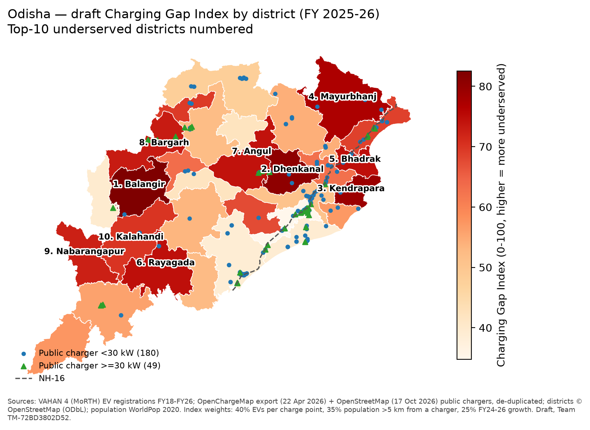
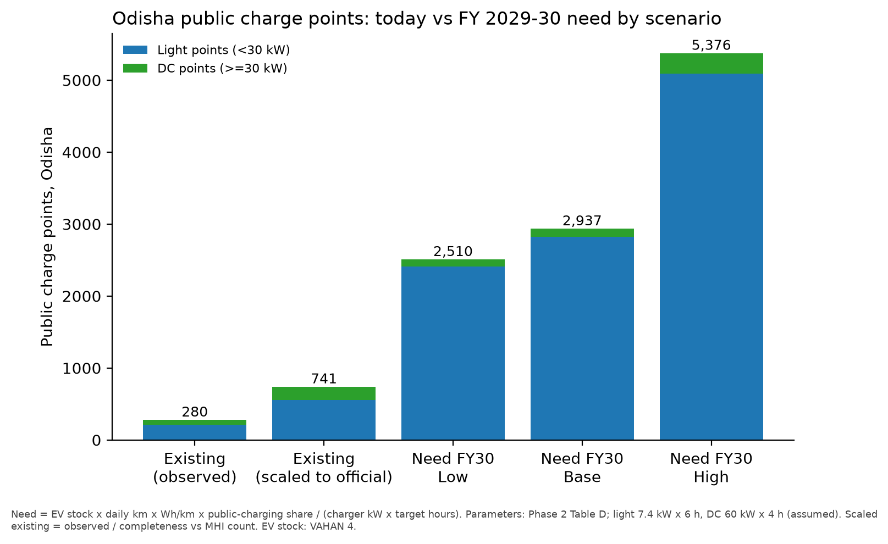

# Phase 3: EDA, forecast and charger need: findings
**EV Infra Map India (C1) · Team TM-72BD3802D52 · 17 Oct 2026**

> This is a private evidence notebook, not part of the submission: [`notebooks/01_eda_forecast.ipynb`](../notebooks/01_eda_forecast.ipynb).
> Scope and parameters come from Phase 1 and Phase 2. ⚠ marks an assumption or an unverified figure.
> Every number below can be traced to a file in `outputs/tables/` or `data/raw/`.

---

## 1. Three headline numbers for the methodology document

| # | Headline | Value | Source / assumption |
|---|---|---|---|
| 1 | **EV pressure on the network: Odisha vs Karnataka** | **~408 EVs per public charging station in Odisha vs ~106 in Karnataka (3.8×)** | EV stock at end of FY 2025-26 is from VAHAN 4 registrations (2W/3W/4W, FY18–FY26, after vehicle attrition): Odisha 2.47 lakh, Karnataka 7.25 lakh. Station counts are from MHI: Odisha 606 (Dec 2025 table ⚠ unverified), Karnataka 6,805 (Rajya Sabha reply, 29 Jul 2026). |
| 2 | **Bhubaneswar fails the MoP 2024 urban norm** | **Only 25% of the city has a public charger within 1 km.** There are 19 stations; the norm (one per 1×1 km) implies about 147. The median distance to a charger is 1.6 km. | The city is the Bhubaneswar Municipal Corporation boundary (OSM, 147 km²), split into 183 H3 hexagons (res 8). Chargers are from OCM + OSM after de-duplication. |
| 3 | **About 4× more public charge points needed by FY 2029-30** | **About 2,940 points needed (Base). The range is about 2,510 (Low) to about 5,380 (High), against about 740 today.** | Formula: EV stock × km/day × Wh/km × public-charging share ÷ (kW × hours), using Phase 2 Table D. Light chargers: 7.4 kW × 6 h. DC chargers: 60 kW × 4 h ⚠. "Today" = the 280 points we mapped ÷ 38% completeness ⚠. |

**Corridor:** NH-16 (about 437 km mapped in Odisha) has **6 stretches longer than 20 km with no public charger** (the longest is 49 km). For DC chargers alone, there are **7 such gaps and the longest is 78 km**. The MoP 2024 norm is one station every 20 km.

---

## 2. Top-10 underserved Odisha districts (draft Charging Gap Index, 0–100)

**How the index is built:**
- **40% load on today's chargers:** EVs per mapped public charge point, on a log scale.
- **35% access:** share of the population living more than 5 km from any public charger. The 5 km threshold is an assumption ⚠.
- **25% momentum:** the district's EV registration growth rate (CAGR) from FY 2023-24 to FY 2025-26.
- Each component is rescaled to 0–100 (min-max normalisation) before weighting.

| Rank | District | Index | EVs FY26 | Mapped points | EVs / point | Population >5 km from a charger | FY24→26 CAGR | Gap to FY30 (Base, points) |
|---|---|---|---|---|---|---|---|---|
| 1 | Balangir | 82.5 | 6,004 | 1 | 6,004 | 98% | 18% | 50 |
| 2 | Dhenkanal | 80.6 | 3,549 | 2 | 1,774 | 89% | 90% | 26 |
| 3 | Kendrapara | 79.2 | 3,547 | 1 | 3,547 | 97% | 38% | 81 |
| 4 | Mayurbhanj | 77.2 | 11,417 | 5 | 2,283 | 92% | 40% | 114 |
| 5 | Bhadrak | 74.6 | 6,471 | 6 | 1,079 | 85% | 90% | 64 |
| 6 | Rayagada | 74.6 | 1,672 | 2 | 836 | 99% | 79% | 7 |
| 7 | Angul | 74.3 | 6,849 | 7 | 978 | 87% | 86% | 76 |
| 8 | Bargarh | 73.1 | 5,654 | 4 | 1,413 | 95% | 43% | 50 |
| 9 | Nabarangapur | 72.5 | 1,322 | 2 | 661 | 97% | 90% | 13 |
| 10 | Kalahandi | 70.1 | 2,189 | 2 | 1,095 | 95% | 56% | 24 |

- **Robustness:** a ±30% change in public-charging share or in charger utilisation keeps **at least 9 of the top-10 gap districts** in place.
- **Where the volume is:** the index ranks how underserved a district is. Absolute need is concentrated elsewhere: **Khordha and Cuttack** hold 39% of the EV stock and 44% of the FY30 point gap.
- **No mapped charger at all:** Malkangiri, Gajapati and Debagarh.

Full table: [`tables/district_summary.csv`](tables/district_summary.csv).

---

## 3. Forecast and backtest

| Item | Result |
|---|---|
| Odisha EV registrations | 990 (FY20) → 92,599 (FY26). FY26 EV share of new registrations is **9.8%**: 2W 10.5%, 4W 5.7%, e-auto/L5 13%. |
| **Backtest: train on FY20–FY24, predict FY25–FY26** | **Holt damped trend: weighted MAPE 10.2%** (2W 6.2%, 4W 16.9%, 3W e-auto 48.4%, e-rickshaw 45.8%). **Log-linear: 507%**, rejected because it extrapolates the 2021–23 take-off. |
| EV stock FY 2029-30 (2W/3W/4W) | **Low 6.8 lakh · Base 8.3 lakh · High 14.4 lakh**, against 2.47 lakh at FY26 |
| Public charging energy FY30 (Base) | about 153 MWh/day |
| Required points FY30, Low / Base / High | Light: 2,413 / 2,822 / 5,088. DC: 97 / 115 / 288. |

How the scenarios are built:
- **Low:** the FY24→FY26 growth rate (CAGR), with the growth halving each year.
- **Base:** Holt damped trend.
- **High:** EV share of new registrations reaches 50% by FY30 (the draft Odisha EV Policy 2025 target, labelled as draft). Each segment's total market stays at its FY26 level ⚠.

---

## 4. What failed, and what to fix before Round 2

| Issue | Impact | Fix |
|---|---|---|
| **Open charger data is thin.** Our mapped sites are **38% of Odisha's official count and only 6% of Karnataka's**. OSM has just 2 chargers in Odisha. | District supply is under-counted, so we scale it to the official total ⚠. Karnataka district-level supply can't be trusted. | Add operator locators (Tata Power, Statiq, ChargeZone, Jio-bp, OMCs) and check against EV Yatra. Get the official MHI state annexure (PDF). |
| **Odisha's official count of 606 is unverified** (third-party copy of an MHI table) | Affects headline #1 and the scaling factor | Download the MHI / Lok Sabha annexure by hand |
| **VAHAN totals vs the state figure:** our gross registrations to FY25 are about 1.64 lakh, but the state said about 2.19 lakh by early 2025 | The stock may be about 25% low (pre-2017 or legacy e-rickshaws, definitions) ⚠ | Ask the Odisha Transport Department, or compare VAHAN "Till Today" totals |
| **3W forecasts are weak** (MAPE 46–48%) | Small effect, since 3W is under 10% of public energy | Segment-specific models; use operator fleet data for e-autos |
| **DC need comes out small** (115 points), because 4W are only 4% of the stock | Energy-based sizing understates highway DC | **Size DC as the larger of the energy-based need and the corridor-norm need** (NH-16 alone needs about 22 DC sites each way at 20 km spacing) |
| **Assumed parameters** ⚠ | Scenario spread | Run sensitivity analysis in Round 2: share of 4W charging done at DC chargers (60%), charger kW, utilisation hours, e-auto attrition (2%), 5 km access threshold |
| **District split of the FY30 forecast** uses each district's FY26 share of the stock | Districts can't converge over time | Round 2: forecast by district, or use a hierarchical model |
| **NH-16 centreline is about 437 km**, shorter than the official length (about 480 km+) | The southern section may be clipped, so gaps may be under-counted | Get the NHAI chainage, or use the full OSM relation |
| **Population is WorldPop 2020** | EVs per lakh population is slightly overstated | Use 2026 projections |
| **Sending data from the browser to disk failed** (the browser pane blocks localhost) | The data had to be passed through by hand | Round 2: scripted, documented VAHAN extraction |

---

## 5. Changes needed to the Phase 1 / Phase 2 decisions

| Phase | Change |
|---|---|
| Phase 2 B (VAHAN access) | **Much easier than planned.** With State selected, set **Y-axis = Rto, X-axis = Vehicle Class, FY**, fuel = ELECTRIC(BOV) + PURE EV. That is **one query per state per FY**, not about 700 exports. |
| Phase 2 A/B (OCM) | **No API key needed.** Use the `openchargemap/ocm-export` GitHub snapshot (22 Apr 2026, 1,872 India sites). Keep the API for live refresh. |
| Phase 2 A (OSM) | Downgrade OSM to a **supplementary** source for chargers (nearly empty in Odisha). |
| Phase 2 C1 (RTO codes) | **Resolved** from the VAHAN office list: OD31 Subarnapur, OD32 Bhanjanagar, OD33 Bhubaneswar-II, OD34 Jajpur, OD35 Talcher, plus ARTOs OD111 Rairangpur, OD201 Khordha and OD901 Barbil. 38 offices map to 30 districts. |
| Phase 1 (Karnataka) | Keep Karnataka as a **state-level benchmark**. Don't do district-level supply analysis until there is a better charger census (completeness 6%). |
| Phase 1 (outputs) | **DC requirement** = the larger of the energy-based need and the corridor-norm need. **Gap Index v1 weights** (40/35/25) carry into the methodology, with the sensitivity result. |
| Phase 1 (time horizon) | Base year can include FY 2017-18 and 2018-19, since VAHAN has Odisha data from 2017. |
